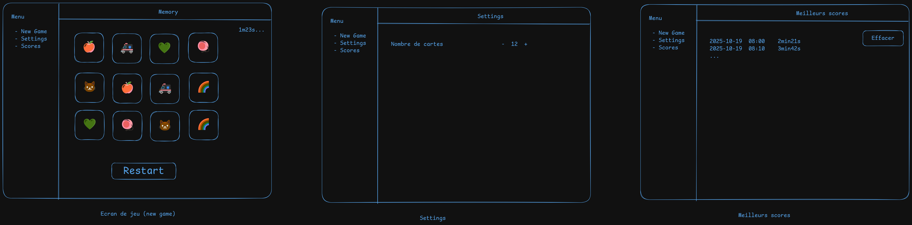

# 🧩 Fil Rouge Angular — Jeu du Memory

**Durée : 7 sessions**
**Niveau : Débutant à intermédiaire**
**Type : Projet ludique, fil rouge pédagogique**

---

## 📅 Découpage des sessions

- Session 1 — Découverte de TypeScript - Création du modèle
- Session 2 — Création de l’application Angular + affichage des cartes
- Session 3 — Persistance des meilleurs scores avec HTTP
- Session 4 — Angular pipes, directives
- Session 5 — Routing : game / settings / meilleurs scores
- Session 6 — Tests unitaires
- Session 7 — Tests end to end
- Session 8 (bonus) — Déploiement GitLab Pages

## Aperçu de l'application

Les 3 écrans en fin de formation :

